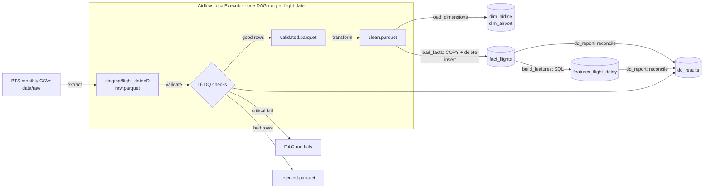
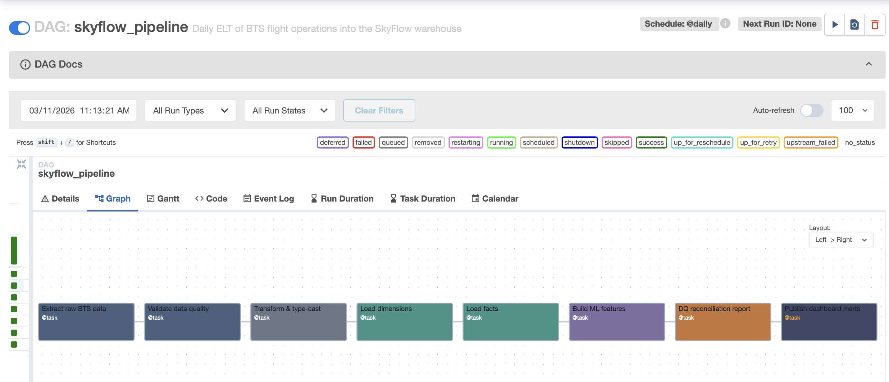
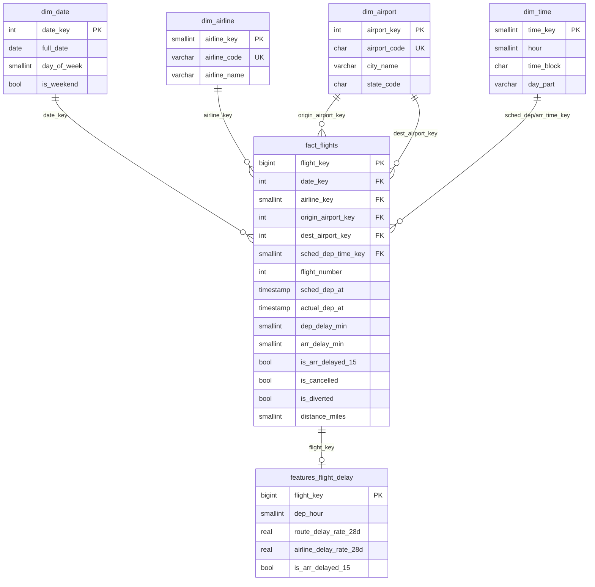

# SkyFlow — Flight Operations Data Pipeline

SkyFlow is an end-to-end batch ELT pipeline for airline operations data. It ingests US DOT/BTS
on-time performance records (1.66M flights, Jan–Mar 2024) and validates each day with 16
data-quality checks. It loads the data into a PostgreSQL star schema with idempotent per-day
delete-insert, and builds a leakage-safe feature table for flight-delay prediction. Apache Airflow
orchestrates the pipeline with daily partitions, retries and backfills. Everything runs locally
with `docker compose up` (native on Apple Silicon).

## Architecture



Two Postgres 16 instances: **warehouse** (`localhost:5442`) and **Airflow metadata** (internal).

## Quickstart

```bash
git clone <repo> && cd skyflow
scripts/download_data.sh 2024 1 3      # ~750 MB of CSV into data/raw/
docker compose up -d                    # warehouse + Airflow; DAG starts catching up immediately
open http://localhost:8080              # admin / admin
```

With `SKYFLOW_CATCHUP=true` (the default), Airflow backfills every day from `SKYFLOW_START_DATE`
to `SKYFLOW_END_DATE`. To re-run or backfill a range manually:

```bash
docker compose exec airflow-scheduler airflow tasks clear skyflow_pipeline -s 2024-02-14 -e 2024-02-16 -y
```

Local development (Python 3.11):

```bash
python3.11 -m venv .venv && .venv/bin/pip install -r requirements-dev.txt
.venv/bin/ruff check . && .venv/bin/pytest -v          # integration tests use localhost:5442
PYTHONPATH=src .venv/bin/python -m skyflow.pipeline --start 2024-01-01   # one day, no Airflow
PYTHONPATH=src .venv/bin/python scripts/train_baseline.py               # baseline model
```

## DAG

`extract → validate → transform → load_dimensions → load_facts → build_features → dq_report`

 <!-- TODO: screenshot from http://localhost:8080 -->

- Daily schedule. Each run processes the flights of its logical date, so re-runs and backfills
  are the same operation.
- `retries=2` (1 min apart), 10-min task timeout, 1-h run timeout.
- `max_active_runs=4` for parallel loading. `build_features` uses `depends_on_past` because its
  rolling history needs every earlier day loaded first.
- The DAG file only orchestrates. All logic lives in `src/skyflow/` and runs the same way from
  the CLI and in tests.

## Warehouse schema

Grain of `fact_flights`: **one row per scheduled flight leg**, keyed by
(flight date, airline, flight number, origin).



## Data quality

16 checks, every result stored in `dq_results` (run id, date, stage, severity, failed rows):

- **Critical. The run fails and nothing bad is loaded:** required columns, non-empty partition,
  nulls in key fields, duplicate natural keys, a reject rate above 1%. After the load, three
  reconciliation checks: raw = clean + rejected, staged = warehouse, and features = flown flights.
- **Row-level warnings. Bad rows go to `rejected.parquet` with a reason:** numeric types, HHMM
  format, distance > 0, scheduled block time > 0, delay within −180…2,880 min, airport code
  format, origin ≠ destination, cancel/divert flags consistent with times.

The 1% reject cap means a broken feed fails loudly instead of being silently filtered away.
During development it caught a real extract bug that turned empty cells into `"nan"`.
See [docs/DESIGN.md](docs/DESIGN.md) for the full rationale.

## Results

Every figure below comes from the run on 2026-11-03: 91 daily DAG runs on a MacBook Air M4,
Docker Desktop with 7.6 GB RAM. The source is `sql/run_metrics.sql` plus Airflow's metadata DB.

| Metric | Value |
|---|---|
| Raw records ingested | **1,658,259** (Jan 1 – Mar 31 2024, 15 airlines, 334 airports) |
| Records loaded after validation | **1,658,251** |
| Rows rejected | **8**: 6 delays beyond 48 h, 2 missing or negative scheduled block time |
| Critical check failures | 0 |
| DQ checks | 16 distinct checks × 91 partitions = **1,456** results recorded |
| DAG runs | **91 / 91 succeeded**, 0 task retries |
| Pipeline runtime (full 91-day backfill) | **5 min 3 s** wall clock (4 concurrent runs) |
| Mean task time per day | extract 0.92 s, validate 0.43 s, transform 0.36 s, load_dims 0.30 s, load_facts 0.88 s, features 0.56 s, dq_report 0.26 s |
| `fact_flights` | 1,658,251 rows (414 MB with indexes) |
| `features_flight_delay` | **1,626,046** rows (187 MB): all flights not cancelled (28,509) or diverted (3,696) |
| Dimensions | 15 airlines, 334 airports, 4,018 dates, 1,440 times |
| Arrival delay ≥ 15 min rate | 20.32% of flown flights |
| Idempotency | Cleared and re-ran Feb 14–16 in Airflow: per-day counts unchanged (16,762 / 19,013 / 19,163), neighbouring days untouched |
| Baseline model | HistGradientBoosting, time-split (train Jan 29–Mar 10: 749,912 rows, test Mar 11–31: 401,905 rows): **ROC AUC 0.663** vs 0.615 for the route delay rate alone |

The AUC is modest by design: features are limited to what is known before departure, with no
weather or inbound-aircraft delay data.

## Project layout

```
dags/skyflow_pipeline.py     Airflow DAG (orchestration only)
src/skyflow/                 extract, validate, transform, load, features, pipeline, config, db
sql/schema.sql               star schema + dq_results + feature table DDL
sql/features.sql             per-day feature build (leakage-safe windows)
sql/run_metrics.sql          numbers for the Results table
scripts/                     data download, baseline model
tests/                       unit (validate, transform) + integration (idempotency, leakage)
docs/DESIGN.md               design decisions and trade-offs
```

## Data source and scope

US Bureau of Transportation Statistics, *Reporting Carrier On-Time Performance* (public domain).
No flight-level public dataset exists for Indian carriers. The pipeline doesn't depend on the
source: adapting it means changing the column map in `config.py` and the extract step.
